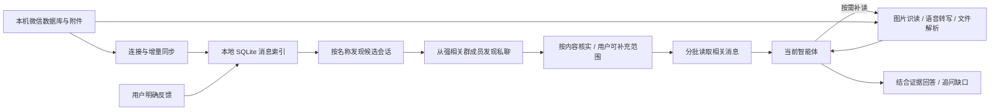

# WeChat Chat MCP

**让 Codex 等智能体自己去微信查资料：跨群聊和私聊检索项目相关对话，读取图片、语音与文件，再综合提取有用信息。**

[](LICENSE)
[](pyproject.toml)
[](#接入智能体)
[](#兼容性与当前边界)

[快速开始](#快速开始) · [接入智能体](#接入智能体) · [使用示例](#使用示例) · [工具列表](#mcp-工具) · [完整使用说明](docs/USAGE.md) · [兼容性](#兼容性与当前边界)

## 直接让 Codex 帮你安装

在**能执行本机命令的 Codex 客户端**里，复制发送下面这段话即可开始。Codex 可以克隆、安装依赖、配置项目并注册 MCP；微信和 Codex 的登录仍由你本人完成。

```text
请在我的电脑上部署 https://github.com/Haoea1024/wechat-chat-mcp 。

先克隆项目，并阅读 README.md、docs/USAGE.md 和 AGENTS.md。
检查是否为受支持的 Windows 环境、Python 是否可用、电脑版微信是否已登录。
在项目目录创建 .venv，安装 .[mcp,media]，连接我指定的微信账户并同步聊天。
如果发现多个微信账户，先让我确认，不要默认选第一个；登录操作由我自己完成。
将 MCP 注册到我当前使用的 Codex，使用本机实际可执行文件的绝对路径，
为附件读取设置 900 秒工具超时；不要覆盖我已有的其他 MCP 配置。
项目名称和别名由我提供，通过 configure_project 或 project add 保存；
我暂时没提供项目时也可以先使用普通聊天检索。
验证 project_status，并用我提供的关键词做一次真实查询。
不要把我的聊天、附件、密钥、本地配置或日志上传到 GitHub。
默认不开启后台自动分析；只有我明确需要时再启用。
首次同步只建本地索引，不让模型通读一个月聊天。
查询时先按群名发现候选，再通过强相关群成员找私聊，按需分批读取正文和附件。
```

这是本地部署入口，不是云端一键读取手机微信。遇到未支持的微信版本、权限或附件格式，Codex 需要根据实际情况处理；不能保证跳过登录和账户选择自动完成所有步骤。手动安装方式见下方。

## 它解决什么问题

项目的信息往往散落在不同的微信群和私聊中：群里讨论需求，私聊补充分工，文件里记录方案，语音里又修改了安排。向智能体求助时，通常需要自己找记录、截图、转发文件，再重新解释背景。

WeChat Chat MCP 将本机微信记录提供给智能体检索。你可以直接说：

> 帮我看看“订单同步”项目最近的讨论。去相关群聊和私聊里找信息，必要时读取图片、语音和文件，告诉我目前进展、关键分歧，以及哪些事情需要我处理。信息不够就直接问我。

智能体可以继续查证据、读上下文和附件，再在当前对话中回答。项目进度页、待办和定时提醒是附加功能；**核心入口是你正在使用的智能体。**

> **当前为 Windows 优先的开发者预览版本。** 新安装不包含任何人的项目分类、聊天或反馈，项目由使用者自己添加；默认关闭后台自动分析。读取能力仍受微信版本、本机同步情况和附件格式影响，详见[兼容性](#兼容性与当前边界)。

## 主要功能

| 功能 | 可以做什么 |
| --- | --- |
| 跨会话查资料 | 搜索群聊、私聊，围绕一个项目或问题收集相关消息 |
| 先发现会话 | 按群名、项目别名和已有关联返回简短候选列表；可进一步按内容找遗漏会话 |
| 从群成员找私聊 | 从强相关群的成员表及近期发言人发现候选私聊，按微信标识关联，避免同名误配 |
| 控制阅读范围 | 分批读取选定会话，限制消息数量与返回字符数，附件正文按需读取 |
| 保存项目资料 | 阅读后按条目更新背景、进展、决定和疑问，保留出处与旧版本；下次优先补读未覆盖或变更消息 |
| 备份重要附件 | 按消息定位并保存本机副本，按内容指纹区分版本，原文件清理后可从校验过的副本继续读 |
| 补读上下文 | 根据命中的会话继续翻阅对话，避免只靠一句话判断进度 |
| 按项目检索 | 对已配置项目结合名称、别名与关联聊天检索，支持分页并按需补读邻近消息 |
| 读取附件 | 识读图片、转写语音、分页读取文档，补充文字聊天以外的证据 |
| 保留出处 | 返回消息 ID、会话、发送者、时间和附件状态，方便核对结论 |
| 自定义项目 | 通过智能体、网页或命令行添加项目、别名和说明，无需修改源码 |
| 接受纠正 | 保存你明确给出的分工、线下进展和理解纠正；可查看、可撤销 |
| 在当前对话分析 | 由使用 MCP 的智能体综合原始资料，不必只复述缓存摘要 |
| 本地增量同步 | 默认收录本机近 30 天群聊和私聊，增量更新并避免重复入库 |

当前检索使用 SQLite、关键词和会话关联，没有向量数据库。原文搜索不会自动理解所有同义表达；智能体可以换用项目简称、业务名或其他关键词继续搜索。

### 图片、语音与文件

| 内容 | 实现方式 | 需要注意 |
| --- | --- | --- |
| 微信图片 | 按消息索引定位本地图片，解码后交给配置的模型识读文字、表格和图意 | 只有缩略图时会注明；识读可能存在错误 |
| 微信语音 | 从对应音频记录提取 SILK，在本机解码并用 Whisper small 转写，保留时间点 | 首次下载模型；同音字、专有名词需要结合上下文核对 |
| PDF | 分页提取文字；有图片或扫描内容的页面渲染后识读 | 长文档需继续分页；复杂矢量图表不保证完整还原 |
| Word / PowerPoint | 读取 DOCX 段落、表格与插图；读取 PPTX 幻灯片文字、表格、备注与插图 | 复杂绘图、嵌入对象和版式可能未覆盖 |
| Excel / CSV | 分段读取 XLSX、XLS、CSV 表格 | XLSX 公式按原文保留；不替代完整的表格计算或图表渲染 |
| 旧版 DOC / PPT | 通过本机 Office/WPS 的 COM 接口转换后读取 | 需要可用的 Windows Office/WPS 自动化接口 |
| 文本与代码文件 | 读取 TXT、Markdown、JSON、XML、常见源码等 | 只读取，不执行 |
| ZIP | 先列出成员，再指定成员名读取正文 | 列出文件名不等于读过成员内容 |

附件通过消息索引或内容指纹匹配，避免把同名旧文件当成当前版本。读取结果缓存在本地；文档每次最多返回五页或五段，可继续分页。

本机没有的内容无法凭空读取。未下载、已清理、读取失败、只读了一部分，会分别体现在工具结果中。视频内容解析暂未实现。

## 快速开始

以下命令在 **Windows PowerShell** 中运行。建议先完成“同步一份聊天 → 接入智能体 → 查询”这条最短路径。

### 1. 准备环境

- Python 3.10+、Git。开发机器使用 Python 3.14。
- 已登录的 Windows 桌面版微信，且本机已经同步了需要查询的聊天。
- 支持本地 **stdio MCP** 的智能体客户端。Codex 为已实测入口。
- 图片识读需要配置模型；默认复用本机 Codex CLI 登录。语音转写使用本机 CPU，不要求 GPU。

Codex 的安装与登录参见 [官方 CLI 文档](https://developers.openai.com/codex/cli)。如果已安装，可以检查：

```powershell
codex --version
codex login status
```

### 2. 下载并安装

```powershell
git clone https://github.com/Haoea1024/wechat-chat-mcp.git
cd wechat-chat-mcp
python -m venv .venv
.\.venv\Scripts\python.exe -m pip install -e ".[mcp,media]"
```

不需要激活虚拟环境。上面的安装包含聊天检索和多媒体依赖。

仅使用文字检索时，也可以安装 `.[mcp]`；读取图片、语音或文档前再补装 `.[mcp,media]`。

当前从源码安装，命令入口仍名为 `wechat-assistant`，Python 包仍名为 `wechat_assistant`。仓库名改为 `wechat-chat-mcp` 不会改变这些命令。

### 3. 连接自己的微信并同步

保持电脑版微信登录，运行：

```powershell
.\.venv\Scripts\wechat-assistant.exe connect
.\.venv\Scripts\wechat-assistant.exe sync
.\.venv\Scripts\wechat-assistant.exe status
```

如果找到多个账户，或微信数据位于自定义目录，请显式指定自己的 `db_storage` 目录：

```powershell
.\.venv\Scripts\wechat-assistant.exe connect --db-dir "D:\WeChatData\xwechat_files\YOUR_ACCOUNT\db_storage"
```

这里的路径是占位示例，请替换为微信设置中对应的数据目录。账户密钥在本机重新获取，不需要作者的账户、登录凭据或数据文件。

第一次默认收录本机近 30 天群聊和私聊，不包括公众号。`status` 中 `total` 是已入库消息数，`sync.ok` 是最近同步状态。`pending` 表示还没有经过后台摘要分析，**不影响智能体直接检索已入库的原始聊天。**

**本地同步不会调用模型，也不会将一个月聊天全部发给智能体。** 同步同时建立会话目录与可用的群成员快照。模型只在查询时接收工具返回的候选信息、消息和按需读取的附件。后台自动分析默认关闭；旧安装保留原设置。

## 接入智能体

### Codex

在仓库目录运行，命令会取得本机的实际可执行文件路径：

```powershell
$wechatMcpExe = (Resolve-Path '.\.venv\Scripts\wechat-assistant.exe').Path
codex mcp add wechat-chat -- "$wechatMcpExe" mcp
codex mcp list
```

在 Codex 用户配置 `~/.codex/config.toml` 中，找到刚创建的服务段，加入附件工具的超时时间：

```toml
[mcp_servers.wechat-chat]
command = 'D:\Projects\wechat-chat-mcp\.venv\Scripts\wechat-assistant.exe'
args = ["mcp"]
tool_timeout_sec = 900
```

`command` 应保留 CLI 注册出的实际路径，不要直接换成上述示例路径。已有相同服务段时编辑原段，不要重复添加。MCP 配置方式依据 [Codex 官方 MCP 文档](https://developers.openai.com/codex/mcp)。

重新加载 MCP 配置或重启客户端后，新建对话验证：

> 使用 wechat-chat 的 project_status 查看同步时间，再用 discover_chats 查“订单同步”的候选群聊。通过强相关群的成员查找候选私聊，先简述范围，再分批读取相关内容。

`codex mcp list` 确认的是配置存在；智能体实际成功调用工具才说明连接可用。

### 其他智能体客户端

本项目提供 **stdio MCP**。在支持本地 MCP 进程的客户端中，填写可执行文件的绝对路径和参数 `mcp` 即可。下面是采用 `mcpServers` 格式的配置示例：

```json
{
  "mcpServers": {
    "wechat-chat": {
      "command": "D:\\Projects\\wechat-chat-mcp\\.venv\\Scripts\\wechat-assistant.exe",
      "args": ["mcp"]
    }
  }
}
```

不同客户端的配置文件位置、顶层字段和工具超时设置可能不同；本项目尚未逐一验证。通用 stdio 配置形式可参考 [MCP 官方参考服务器的客户端示例](https://github.com/modelcontextprotocol/servers#using-an-mcp-client)。

客户端应在能读取这台 Windows 电脑数据的本地环境中运行。`http://127.0.0.1:8766` 是附加网页，不是 MCP HTTP 地址；本项目没有提供可直接填写到远程连接器中的 HTTP MCP 服务。

详细步骤、模型配置与排错见 [智能体使用说明](docs/USAGE.md)。

## 使用示例

以下名称均为虚构示例，可替换为实际项目名称。未配置项目分类时，从关键词搜索开始。

### 查一个项目的最新情况

> 帮我查“订单同步”的最新进展。先按群名和“订单接口”等别名找群，再从强相关群成员发现私聊；必要时按“同步失败”等关键词补查遗漏会话。简述准备查看的范围，我可以补充。分批阅读有用的讨论，告诉我当前状态、下一步和重要疑问。

成员关系只用于发现线索，不会自动将某个人的全部私聊归入项目。首次范围不明确时集中补充一次；用户明确确认的会话可通过 `set_project_chats` 保存，后续查询复用。用户不必每次先手动整理群聊和联系人清单。

### 保存资料，下次接着查

> 把已经读过的内容整理成项目资料，保留分工、期限、重要限制和未解决问题，并附消息出处。重要方案文件保存本地备份。以后先恢复资料和补读新增变化，遇到矛盾或需要细节时仍然回查原文。

已配置项目可使用 `get_project_brief` → `read_project_updates` → 按需补原文/附件 → `save_project_brief`。资料按稳定条目合并，未提到的疑问不会被下一次保存自动删掉；旧版本可回看。助手整理的说法、推测和待核实问题会分开记录，不当作用户确认。

阅读覆盖按具体消息内容记录，不简单按“上次读到的日期”截断，因此迟到的旧消息、修改过的原文和附件读取内容变化仍可被发现。只读了一页不能标记整个群已读，截断的长消息需补读全文。资料中会显示阅读范围、待复核标记及引用附件的实际页段；原始检索入口始终可用。

### 补读附件

> 刚才讨论里提到方案文件和一段语音，请读取正文和转写结果再判断。长文件继续分页，不能只根据文件名猜内容。

### 核对不同会话的说法

> 群里说已经交付，私聊里却还在催修改。把相关上下文找出来，区分提交、试用、验收这几个状态，并给出消息出处。

### 告诉智能体真实分工

> 这件事我只负责接口，不负责前端。请把这条反馈保存到对应项目，之后不要把整个团队的任务都算给我。

未配置对应项目时，可以先保存为全局反馈，或限定到检索返回的会话/消息。

### 补充线下进展

> 这项工作昨天线下已经完成了，请记住这个补充。原来的群聊没有更新，所以不要继续据此判断我没做完。

### 撤销反馈

> 列出我之前保存的反馈。我来指定哪些已经过时，再撤销指定的记录。

## MCP 工具

| 工具 | 用途 |
| --- | --- |
| `project_status` | 查看消息覆盖、同步时间、后台分析与错误状态 |
| `list_projects` | 查看已配置项目、关联聊天、摘要、事项和有效反馈 |
| `configure_project` | 按用户明确要求添加或修改项目名称、别名、说明与跟踪状态，保存到本机 |
| `discover_chats` | 首先按名称和已有项目关联发现候选；可开启内容匹配找遗漏会话，仅返回元数据，支持分页 |
| `find_private_chats` | 从选定强相关群的成员及发言人发现候选私聊，返回成员依据、消息数与关键词命中数，支持分页 |
| `set_project_chats` | 保存用户明确确认的会话关联或排除，不自动保存推测 |
| `get_project_brief` | 分页恢复当前项目资料、出处、变更提示和附件位置；指定 `version` 可回看旧版本 |
| `save_project_brief` | 按稳定 `key` 更新有出处的资料条目，保留未解决条目与历史版本；保存具体消息的阅读覆盖 |
| `read_project_updates` | 找出候选范围内未覆盖/修改的消息和附件缓存变化，包含迟到旧消息，支持分页 |
| `backup_attachment` | 按消息 ID 复制并校验重要附件到本机备份目录，保留同名文件的不同版本；备份不等于阅读 |
| `search_messages` | 限定会话、项目关键词和天数搜索，分页返回正文预览；默认 20 条、消息列表 12000 字符 |
| `search_chat` | 保留旧客户端兼容：按原文片段搜索，最多最近 60 条，无分页；新查询优先使用上述流程 |
| `get_messages` | 按消息 ID 读取原始记录及已缓存的附件内容；单次最多 100 个 ID |
| `get_project_context` | 在发现会话后读取已配置项目，可限定 `chat_ids`；默认 20 条、12000 字符，不自动扩展邻近消息或附带附件正文 |
| `read_conversation` | 分页读取选定会话，可按起止时间补上下文或读新增消息；默认 20 条、12000 字符，每页正序呈现 |
| `list_attachments` | 分页列出图片、语音和文件；限定项目时使用已关联会话 |
| `read_attachment` | 识读图片、转写语音、分页读取文件，或读取 ZIP 指定成员 |
| `remember_feedback` | 保存用户明确给出的补充或纠正，可限定项目、会话、消息 |
| `list_feedback` | 查看有效反馈 |
| `revoke_feedback` | 撤销指定反馈，保留历史记录 |

另提供 `review_work(project)` MCP 提示模板，供支持提示模板的客户端调用；普通对话不依赖此模板。

对微信本身只读。反馈、缓存和分析状态写入本地助理数据库，不修改微信原文，也没有发送微信消息的工具。

## 工作方式



MCP 读取已经同步的记录，不会因为一次查询就自动把手机端全部历史同步到电脑，也不会自动调用本项目的 `sync` 命令。需要新消息时，先运行 `sync`，或启用附加后台持续采集。

群名用于优先发现，不是唯一筛选条件。`discover_chats(include_content_matches=True)` 可在本地按消息和已缓存附件内容搜索遗漏会话，仍不返回全文。确定范围后用 `search_messages`、`read_conversation` 或 `get_project_context` 阅读；证据足够即可停止，无需为了翻完分页读取整个项目历史。

普通分页不会重复附带已解析的附件全文，单条消息正文超过 2000 字符会标记 `text_truncated`，需要时用 `get_messages` 补读。`max_chars` 是消息列表序列化后的字符预算，不是精确 token 限额，也不包含工具的其他元数据。附件与全文读取是显式补读，另有各自限制。

已有安装更新后运行一次 `sync` 刷新会话目录和成员快照，再让客户端重新加载 MCP 工具。成员表不可用时，只能通过已同步群消息中的发言人发现部分私聊；工具会返回覆盖状态。无近期消息不代表没有历史消息，群成员也不一定与你有已同步的私聊记录。

**项目资料用于恢复背景，原文用于查证。** 新消息不会自动证明旧结论失效，旧摘要也不能证明当前情况未变。涉及矛盾、精确数字、负责人、期限或重要决定时，智能体应补读相关原文和附件。资料不设强制压缩字数，不为了缩短摘要丢掉关键限制；保存与更新由当前智能体调用工具完成，不新增后台总结任务，也不能自动清除客户端已有的长对话上下文。

`backup_attachment` 保存真实文件副本，不只保存路径。文档可直接备份；图片与语音先解码读取，再备份可用图像/音频，缩略图会保留质量标记。副本位于助理数据目录的 `backups` 中，读取时校验 SHA256；同名不同内容分别保存，原件不改。它用于防止微信附件清理后丢失可读副本，同盘存储不能替代异地灾备，当前不自动清理旧备份。

## 可选：进度页面与主动提醒

需要持续同步时，可以启动后台；新安装默认只采集，自动分析需自行启用：

```powershell
.\.venv\Scripts\wechat-assistant.exe serve
```

浏览器打开 [本地页面](http://127.0.0.1:8766)。也可双击 `start.cmd` 隐藏运行；关闭网页不会停止后台。

- 默认目标采集间隔 60 秒。需要摘要和提醒时，在设置中启用“自动分析已配置项目”；分析目标间隔为 600 秒，每批 120 条，历史积压时分批继续。
- 默认每天 08:00、12:00、18:00，北京时间、含周末，汇总有变化的事项；明确紧急事项分析后额外提醒。
- 可在页面补充资料、纠正聊天关联、输入反馈、补导更早记录和调整频率。
- 后台分析会调用配置的模型并消耗对应额度；仅运行 MCP 查询快照不启动此分析循环。
- 任务串行执行，模型处理可能推迟下一次采集。电脑休眠、后台退出或微信未同步期间无法实时提醒。

## 兼容性与当前边界

### 不是绑定一台电脑，但也不是所有环境都已适配

| 环境或能力 | 当前状态 |
| --- | --- |
| 作者电脑：Windows、微信 4.1.15.56、Python 3.14 | 已实测连接、聊天同步、MCP 查询、图片、语音和多种文档读取 |
| 其他 Windows 电脑与账户 | 可以自行安装、连接自己的数据目录；需要实际验证密钥获取、数据库结构和附件格式 |
| 其他 Windows 微信版本 | 未形成完整兼容矩阵；不能承诺所有 4.x 版本通用 |
| macOS / Linux | 上游含对应平台代码，但本项目完整流程尚未验证；新版图片密钥定位及部分附加功能依赖 Windows |
| Codex | 已实测 stdio MCP 调用及本机 Codex CLI 模型入口 |
| 其他支持本地 stdio MCP 的智能体 | 协议上可接入，尚未逐客户端实测 |
| Chat Completions 兼容 API | 代码支持，尚未端到端验证；相关能力需要 JSON Schema 与图片输入支持 |
| 手机微信、企业微信、多人服务、无微信环境的服务器 | 不作为当前支持目标 |

### 项目由你自己配置

新安装的项目列表为空，原文检索可以直接使用。需要按项目聚合时，告诉智能体：

> 请添加一个“客户门户”项目，别名是“门户系统”和“客户登录”；我负责接口开发，重点关注联调和验收。以后查这个项目时，结合相关群聊和私聊。

智能体调用 `configure_project` 即可。也可以在网页点击“添加项目”，或在命令行添加：

```powershell
.\.venv\Scripts\wechat-assistant.exe project add "客户门户" --alias "门户系统" --alias "客户登录" --notes "我负责接口开发，关注联调和验收。"
.\.venv\Scripts\wechat-assistant.exe project list
```

项目名称、别名和说明写入助理数据目录中的 `config.json`，反馈、聊天关联和进度保存在同一目录的 SQLite 数据库中。可以配置任意数量的项目，不需要修改提示词或源码。

旧安装会保留其本地项目和反馈，不把这些内容打包进开源代码。详细配置方法见[使用说明](docs/USAGE.md#管理自己的项目)。

### 检索范围与准确性

只能检索已经导入本机资料库的记录。关键词搜索不是全语义检索，按项目取一页上下文也不等于看完该项目的全部聊天。工具会返回相关分页信息，智能体应按需补读。

图片识读、语音转写和进展推断都可能有误。结论应保留出处，重要缺口直接问用户；有效用户反馈优先于自动推断。

## 数据与模型

| 数据 | 默认位置或去向 |
| --- | --- |
| 消息、项目、反馈、事项 | `%USERPROFILE%\.wechat-project-assistant\assistant.db` |
| 项目资料版本、阅读覆盖、附件出处与备份索引 | 同一 SQLite 数据库；不写入源码仓库 |
| 解密缓存、媒体读取结果、语音模型 | 同一目录下的 `wechat-cache`、`media`、`models` |
| 重要附件的本机副本 | 同一目录下的 `backups\内容指纹\文件名` |
| 助理配置与图片解码参数 | 同一目录下的 `config.json`、`image-keys.json` |
| 微信连接配置与数据库密钥 | `%USERPROFILE%\.wechat-cli\` |
| 智能体收到的检索结果 | 进入所使用智能体的模型上下文 |
| 图片识读、网页问答、后台分析 | 相关材料发送给本项目配置的模型入口；默认使用本机 Codex CLI 登录 |
| 语音解码与转写 | 在本机执行；转写文本可能作为后续分析上下文 |

本地存储不等于所有推理都在本机执行。项目不会把微信数据库密钥发送给模型。请不要将聊天数据库、缓存、密钥或真实聊天截图提交到公开仓库。

## 开发与贡献

```powershell
.\.venv\Scripts\python.exe -m unittest discover -s tests -v
```

测试使用虚构数据，覆盖会话发现、群成员身份关联、同名隔离、成员缺失、用户排除、字符预算与分页不漏消息，以及消息重放、项目配置、反馈与撤销、引用校验、附件定位/解析、图片解码及提醒去重。

项目资料与备份还覆盖：未解决问题保留、历史版本、局部阅读不跳过邻近消息、迟到旧消息、原文修改、反馈撤销、附件分页出处、同名版本隔离、备份损坏检测，以及原文件删除后通过真实 stdio MCP 读取副本并保存资料。测试不等于所有微信版本和文件格式均已实测。

欢迎通过 Issues 反馈版本适配情况和问题。当前仓库由维护者独立写入，不接受外部 Pull Request；公开源码仍可下载和 Fork。请提供操作系统、微信版本、Python 版本、出错步骤及脱敏后的错误信息，不附聊天数据库、密钥或完整私人对话。实现约定见 [AGENTS.md](AGENTS.md)。

## 致谢与许可证

采用 [Apache-2.0](LICENSE) 许可证。

- [huohuoer/wechat-cli](https://github.com/huohuoer/wechat-cli)：微信数据库访问与消息解码基础；保留的上游说明见 [UPSTREAM_README.md](UPSTREAM_README.md)。
- [maomao3334/wechat-cli-plus](https://github.com/maomao3334/wechat-cli-plus)：Windows Config.Cipher 兼容实现参考。
- [fanyuantaier/wechatauto-replica](https://github.com/fanyuantaier/wechatauto-replica)：图片格式与密钥定位参考。
- [MCP Python SDK](https://github.com/modelcontextprotocol/python-sdk)、[faster-whisper](https://github.com/SYSTRAN/faster-whisper) 及相关文档解析依赖。

具体来源、提交版本和本地改动归属见 [NOTICE](NOTICE)。
